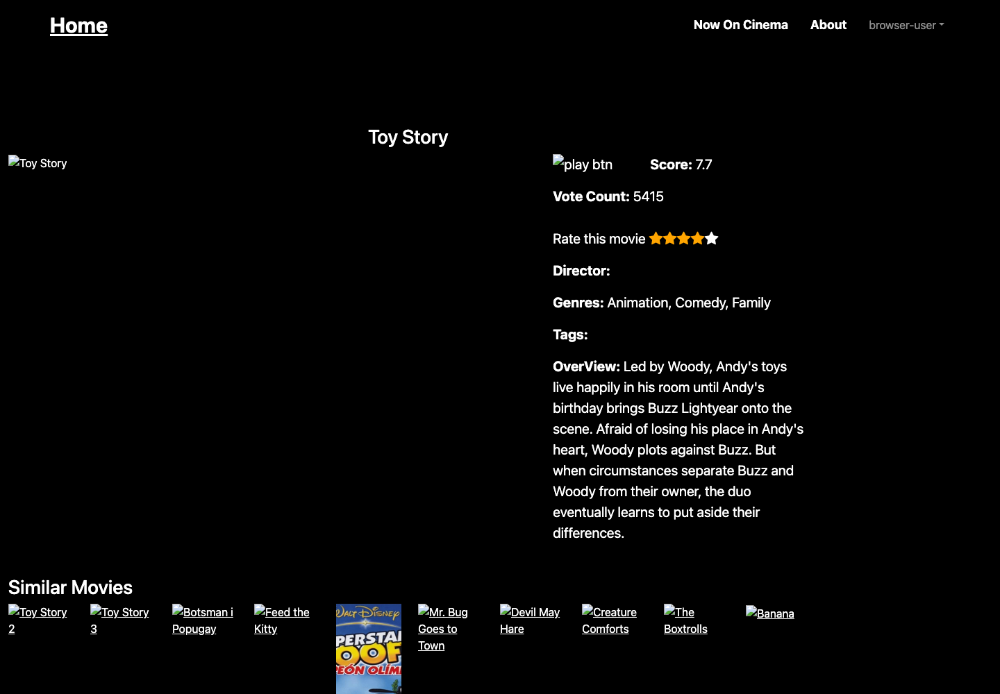

# Security review and dependency upgrade

Reviewed on 2026-10-31. This covers application authentication/ratings, active
npm/Python dependencies, the optional research dependency set, CI configuration,
and high/critical CVEs in the two local arm64 Docker runtime images. It is not
a penetration test or a guarantee that no vulnerabilities exist.

## Versions verified against upstream stable releases

| Component | Updated version |
| --- | --- |
| GitHub Actions runner | Ubuntu 26.04 (latest available Ubuntu hosted runner) |
| API Docker runtime | Python 3.15.2 / Alpine 3.24 |
| Frontend Docker runtime | Node.js 26.13.0 / Alpine 3.24 |
| Vue / Vue Router | 3.5.44 / 5.4.0 |
| Vite / Vue plugin | 8.3.5 / 6.0.10 |
| ESLint / Vue lint plugin | 10.14.0 / 10.12.0 |
| Bootstrap / Bootstrap Icons | 5.3.8 / 1.13.2 |
| Flask / Flask-Cors | 3.1.3 / 6.0.5 |
| Flask-Limiter / Gunicorn | 4.1.1 / 26.2.0 |
| NumPy / pandas | 2.5.4 / 3.1.0 |
| scikit-learn / scikit-surprise / SciPy | 1.9.1 / 1.1.5 / 1.18.1 |

Ubuntu 26.10 exists, but GitHub's newest supported Ubuntu runner is 26.04.
Runtime Docker images use Alpine, independently of the Ubuntu CI host.
Version checks used npm/PyPI metadata, official Node release metadata, the
Docker Python image manifest and GitHub runner documentation. The optional
SVD stack is tested separately with Python 3.14 in CI; full research training
still requires the absent original datasets.

## Findings and changes

- npm initially reported 33 affected dependency entries, including 8 high.
  Replaced the unsupported Vue 2/Vue CLI stack with Vue 3 and Vite and removed
  jQuery, old Bootstrap JavaScript, Popper scripts and remote CSS dependencies.
  Bootstrap and icons are now bundled locally. A minimatch override selects
  the patched 11.x implementation; lint and builds verify compatibility.
- pip-audit flagged Flask 3.1.2 (the feed listed the same advisory twice).
  Upgraded Flask to the fixed 3.1.3 release and refreshed all direct runtime
  and research dependencies.
- Requests previously had no body size limit or login throttling. Added a
  16 KiB request limit, bounded login inputs, IP rate limits and JSON 413/429
  responses. Added regression tests for these behaviors.
- Sessions were stored as bearer tokens in SQLite. They are now SHA-256
  digests. Existing sessions migrate automatically without deleting accounts,
  ratings or client tokens. Regression tests cover migration and logout.
- API responses now disable caching and MIME sniffing. Compose publishes
  ports only on 127.0.0.1. Docker uses Gunicorn rather than Flask's development
  server. The web container runs as the unprivileged node user.
- Image scans initially found Debian packages without vendor fixes and
  vulnerable libraries bundled with pip/npm. Changed the API base to current
  Alpine and removed package managers after dependency installation. Runtime
  images intentionally require a rebuild to change dependencies.
- GitHub Actions are pinned to verified v6 commit SHAs.
  CI now audits npm, runtime Python and optional research dependencies, builds
  images and scans image archives using Trivy 0.76.1. The scanner gets only
  read-only archives, never the Docker socket. Dependabot checks weekly.

## Validation results

- npm audit: **0 reported vulnerabilities**; npm outdated: no outdated direct packages.
- pip-audit runtime and research requirements: **no known vulnerabilities**.
- Trivy 0.76.1 final API/web image scans: **0 HIGH and 0 CRITICAL** each.
  Lower severity findings are outside this scan's filter. Initial findings
  were addressed rather than ignored with scanner suppression rules.
- Seven API integration/security tests passed locally and in Python 3.15.2
  containers; frontend lint and production build passed, including Node 26.
- Optional SVD synthetic fit/predict and content similarity smoke check passed
  with the upgraded scientific stack on local Python 3.13.
- Chromium passed registration, wrong password, login, rating save/reload,
  API restart persistence and logout. The flow was repeated using both final
  Docker images with an isolated network and temporary SQLite database.

Screenshot of the migrated UI after saving/reloading a rating:

## Remaining deployment considerations

- This is a local development Compose setup. Vite is a development server;
  public deployment needs static hosting/reverse proxy, HTTPS and its own review.
- Bearer tokens remain in localStorage and are readable by JavaScript. Vue
  escapes template values and external scripts were removed, but an XSS bug
  could still steal a token. HttpOnly cookie authentication is not implemented.
- Rate-limit state is in memory and resets when the API restarts. The Docker
  command intentionally uses one Gunicorn worker. Multiple workers/replicas
  need shared limit storage and explicitly trusted proxy configuration. Clients
  behind a common proxy currently share the immediate IP bucket.
- The API container still runs as root to support existing root-owned SQLite
  volumes. Back up and migrate volume ownership before enforcing a non-root API.
- Poster images remain external URLs; dataset completeness and recommendation
  quality were not evaluated by this security review.
- Audit results are snapshots of advisory databases, package versions and the
  scanned architecture. New reports can make CI fail later; review and upgrade
  affected packages rather than disabling the checks.
